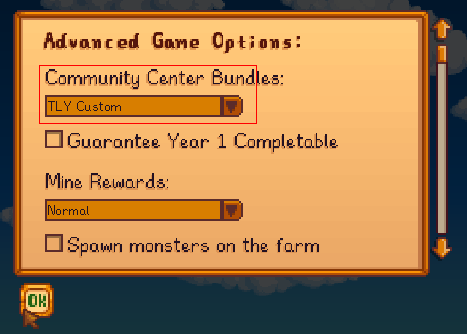
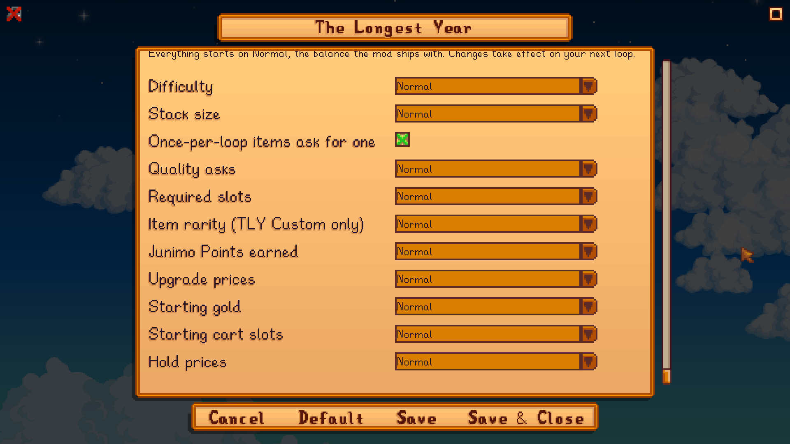
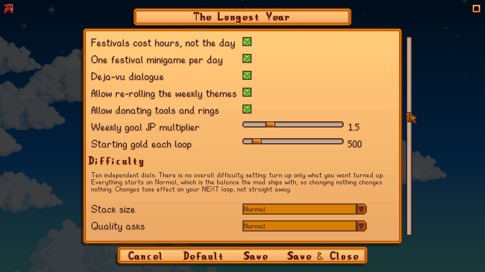

# The Longest Year

**Restore the Community Center within a single year — or the Junimos rewind the seasons and you begin again, a little stronger.**

A roguelite time-loop for Stardew Valley (PC).

⬇ **[Download on Nexus Mods](https://www.nexusmods.com/stardewvalley/mods/47192)**

**The Longest Year** turns Stardew Valley's first year into a roguelite loop. Each season asks you to give back enough of the land's bounty to the old Community Center hall. Fall short by a season's end and the Junimos turn time back to Spring 1 — the world resets, but the strength you've earned (and the power your offerings bank) can carry forward. Restore the whole Center inside one year to break the loop for good.

**Version 1.1.** The full first year, story and all. Bug reports and balance feedback are still very welcome; see [Giving feedback](#giving-feedback) below.

---

## See it played

**Emmalution** is playing the whole loop on YouTube, and her edited episodes are the best introduction to the mod there is. Thank you, Emma, for the videos and for the bug reports that came with them.

- Spring: [I must donate to the Community Centre OR RESET!](https://www.youtube.com/watch?v=fU4EVzlD1K8)
- Summer: [The Junimos challenged me to complete these bundles...](https://www.youtube.com/watch?v=WaAzDjMWmt8)

Channel: [youtube.com/@emmalution](https://www.youtube.com/@emmalution)

---

## What's New in 1.2.21

**Fixed: bundles asked for dishes you can't cook in year 1.** On Easy and Normal, bundles no longer ask for dishes like Pink Cake, whose recipe only airs as a Sneak Peek of next year's cooking show, unless you've kept that recipe in your Cookbook. Hard and Extreme still ask for them. On Easy, Home Cook's Feast could also ask for dishes with no way to get them at all. It can't any more. Thanks to Nijah.

**Fixed: the same bundle reward could turn up again and again.** The Longest Year's own bundles now take an unused reward from their room's normal rewards, so a board no longer hands out two Kegs or two Preserves Jars. With Random bundle rewards on, each bundle draws from its own room's rewards first, and no reward repeats on a board until all of them have been handed out. Thanks to Nijah.

**Fixed: a board could have several bundles about the same thing.** A board now has at most one cooking bundle, one artisan goods bundle and one minerals bundle whenever there are others to pick from. Seasonal crop and foraging bundles are not affected. A board you keep at the rewind is rebuilt with these rules, so a few of its asks may change. Thanks to Nijah.

**New: pin the upgrades you're saving for.** Press Y or right-click an upgrade in the Junimo Shrine to pin it. Pinned upgrades sit at the top of their tab, in the JP shop at the rewind and on the Plan tab of the shrine on your farm. A line above the list tells you how many of your pins you can afford and how much more JP the next one needs. Thanks to Nijah for the idea.

**New: a recap at the end of each loop.** Before the JP shop, one page shows the JP you earned and where it came from, how many bundles you finished, how many donations were still needed and what the darkness did. It also suggests up to three upgrades based on the asks you missed, or on the board you're keeping. Suggested upgrades are marked with a green ! in the shop.

**New: easier shopping in the Junimo Shrine.** Each tab shows how many of its upgrades you own. Hovering an upgrade with more tiers shows the next ones and what the rest cost. An Affordable only box (LT on a controller) hides what you can't buy yet. On the Plan tab, upgrades you can't afford are faded, like in the shop.

## 1.2.15

**Fixed: a kept skill level's recipes showed up a day late.** Keeping a skill level through a rewind brought the level back, but the recipes that level unlocks, like the Scarecrow at Farming 1, only appeared after your first sleep. They are now there from the first morning. Thanks to JazzDaxx.

**New: the Keeping Book's recipe picker sorts recipes by where they come from.** With mods that add recipes, a row of tabs above the picker shows one source at a time: the base game's recipes first, then each supported mod's, then other mods' and all of them, each sorted A to Z. LB and RB, left and right on the tab row, or a click switch tabs. Recipes now show their proper names instead of a mod's internal id.

## 1.2.12

**Fixed: Sword and Sorcery's offhand weapon stayed equipped through the rewind.** Equipment slots that other mods add through SpaceCore, like Sword and Sorcery's offhand weapon and armor slots, kept their items into every new loop. They now empty with your boots and rings, and Keep Worn Gear keeps them. Thanks to Celjhyn.

**Fixed: a controller could not move down the Junimo Shrine's rows.** On the shrine on your farm, pressing down never left the first row. Up and down now move through the rows, scroll the list at its ends, and go back up to the tabs. The JP shop at the rewind moves the same way. Thanks to Celjhyn.

**Fixed: some mods' fish were left out when sizing fish asks.** A mod that writes its fishing rules in lower case, like Alchemistry, had its fish ignored, so the fish asked for could be larger than what you can really catch with that mod installed. Those fish now count.

## 1.2.7

**Fixed: the save after a rewind could freeze with Ultra Smooth.** On a large mod list the game hung on the first save after a rewind while Ultra Smooth's memory cleanup was on. The Longest Year now clears the way before that save. Thanks to Celjhyn.

**Fixed: Defense Division's characters said goodbye right after a rewind.** The mod's stay timer was wiped while its scenes stayed seen, so the goodbye letter came early. Mod countdowns like this now start over each loop. Thanks to Celjhyn.

## 1.2.6

**New: six more Cornucopia crops can be asked for.** With Cornucopia More Crops and Item Extensions installed, Sugar Beet, Asparagus, Chickpea, Zucchini, Barley and Celery can now turn up on a board with mod items allowed. Their seeds only come out of Mixed Seeds in year 1, so the amount asked is sized from how many Mixed Seeds you can gather and how likely each seed is. Bags you save carry over to later seasons, and a board that asks for several of these crops shares the bags between them.

## 1.2.5

**New: Seven Deadly Sins is supported.** The Longest Year now knows the mod's crops, fish, machines and shops, and when each can first be reached. The mod's own way into the Secret Woods opens them in week 1. Thanks to SylviaStormsinger.

**New: two shrine keeps for Seven Deadly Sins.** Keep Cliff Road (350 JP) and Keep Old Mine Open (1,000 JP). They are only shown with the mod installed.

**Changed: Unlockable Bundles progress rewinds with the loop.** Paid bundles, their wallet currencies and prize machine progress carried into every later loop. They now reset at the rewind.

**Changed: Keep Minecarts opens Deep Woods early.** With Deep Woods installed and Keep Minecarts owned, Deep Woods and the Secret Woods open in week 1.

**Fixed: Midnight Carp asked for in Summer.** Seven Deadly Sins lists the carp with no season in a cave that opens late. It is back to Fall and Winter. Thanks to SylviaStormsinger.

**Fixed: the Wolf Staff was lost after the first loop.** The pickup now resets with the loop, so the staff is in the woods again each time. Thanks to SylviaStormsinger.

**Fixed: Deep Woods could not be walked into with Stardew Valley Expanded.** The passage from the Secret Woods was walled off. It is open again.

**Fixed: Stardew Valley Expanded's western log stayed gone.** From the second loop the Secret Woods stood open on day 1. The log now comes back each loop.

**Fixed: Mixed Seeds odds with Cornucopia and Item Extensions.** The Cultivation upgrades, the Year-Two Seeds boost and Fall Artichoke Seeds had dropped to a seventh of their odds. They are back to normal.

## 1.2.4

**New: Deep Woods is supported.** The Longest Year now knows what the Deep Woods hold and how deep you have to go for it. Levels 1 to 9 open with the Secret Woods in week 4. From level 10 the woods hold Skull Cavern monsters, so those items wait until the mines are cleared. The rewind takes your Deep Woods progress back to a fresh game, and the unicorn's Stardrop can be won again each loop.

**New: Keep Stardrop (Unicorn).** A new shrine keep for 500 JP. The Deep Woods unicorn's Stardrop stays with you every loop. It is only shown with Deep Woods installed.

**Changed: Stardew Valley Expanded unlocks rewind with the loop.** SVE's story orders, Grandpa's Shed, the Summit shortcut and its three masteries carried into every later loop for free. They now wipe at the rewind like the base game's unlocks, and you can earn them again each loop.

**New: four shrine keeps for Stardew Valley Expanded.** Keep Cheese Mastery (150 JP), Keep Craft Mastery (350 JP), Keep Brewing Mastery (350 JP) and Keep Grandpa's Shed (1,800 JP). The shed comes back repaired and empty. They are only shown with SVE installed.

**Changed: Pierre's Special Order covers Cornucopia More Crops.** With that upgrade, Pierre also sells Cornucopia's year 2 seeds in year 1.

**Fixed: heart events in a mod's own maps replay each loop.** A heart event set in a place a mod adds stayed seen after the rewind and never played again. Heart events now replay wherever they happen.

**Fixed: the Secret Woods, the Sewer and the Witch's Swamp counted from day 1.** The darkness and the Traveling Cart treated their items as within reach on Spring 1. Secret Woods items now wait for week 4, the Sewer, the Mutant Bug Lair and Krobus's shop for week 7, and the Witch's Swamp for week 13, the weeks the board already opens them.

## 1.2.3

**Fixed: the Four Seasons Sampler could miss most of the year.** Coconut and Cactus Fruit have no season, and just one of them made the bundle count as covering all four, so it could roll with only Summer and Winter items. It now names at least three seasons, and those two don't count toward that. Your current board keeps its items until the next loop. Thanks to JazzDaxx.

**Fixed: tapper goods only checked for the Tapper, not the tree.** Fiddlehead Fern, Red Mushroom and Purple Mushroom could be asked for in Spring because the mod assumed you could tap a tree for them, but those trees only turn up with green rain or by chance in Fall. Fiddlehead Fern now comes due from Summer. Thanks to JazzDaxx.

**Changed: Red and Purple Mushroom now follow the mines.** With the tree route gone, they date from where you can really find them. Red Mushroom can be asked for from week 1, as a hard roll: a 10% find below floor 20, except on floors 40 to 79. Purple Mushroom can be asked for from week 3: a 5% find below floor 80.

## 1.2.2

**Fixed: SpaceCore skills carried through the rewind.** Luck Skill, Cooking, Archaeology and any other SpaceCore skill now reset at the rewind like the vanilla five. A carried Luck Skill level also counted toward mastery, so mastery could start too early. Thanks to SylviaStormsinger.

**Fixed: Exp Boost and Mastery Boost are decided skill by skill.** With a luck mod, your skill total could reach mastery while a skill was still under 10, and that skill lost its Exp Boost. Skill XP and mastery XP now scale separately, and a mastery level is announced once. Thanks to SylviaStormsinger.

**Fixed: Crash Course gives exactly what you paid for.** Exp Boost could stretch one bought level into several. Crash Course now skips Exp Boost and adds no mastery XP.

**Fixed: crop bundles no longer ask for things that aren't crops.** Fiber and wild seeds could turn up in Quality Crops and the season Crops bundles. They are out of the crop pool, and an open ask like that on your current board is swapped the next time you load. Thanks to elaineofshalott.

**Fixed: the rewind with larger mod lists.** The rewind's save no longer announces a second morning, even when another mod patches SMAPI's events, so Farm Type Manager can't spawn twice and block the next save. The new save folder now exists before the reload, so mods that need its path, like SpaceCore and Stardew Valley Expanded, no longer fail there. Thanks to Celjhyn.

**Fixed: safer saves when a mod leaves something behind.** An object the game can't save is set aside for the save and put back more reliably, even when the save fails. If a mod's character is what breaks a save, the log now names it and its mod.

**Fixed: the old farmhouse could show during the rewind.** A long stay in the Junimo Shrine could lift the black screen behind the menu.

**Fixed: the Keeping Book with a controller.** One press of A on an empty slot opened the picker and chose an entry at the same moment. It now opens the picker and waits for you. Thanks to Celjhyn.

**Changed: tab labels with a space are centered on their letters.** This is for the Herd Book tab's off-center label. Thanks to SylviaStormsinger.

## 1.2.1

**New: one Keeping Book.** The Cookbook, Craftbook and Herd Book are now one book with a tab for each page. Your old books turn into it the next time you load. Thanks to tanky24u for the idea.

**New: Banish.** At the rewind, the shrine's Foresight tab lets you spend JP to keep a bundle or an item off the next loop's board, up to two a loop. If the board can't be filled without it, your JP comes back. Thanks to RosemaryBagels for the idea.

**Changed: more time at the night festivals.** With Festivals cost hours on, the clock at Spirit's Eve and the Moonlight Jellies runs at half speed, so there is time to talk, shop and explore before the main event. Night festival clock speed in the settings goes as low as 10%. Thanks to Nijah.

**Fixed: weekly goals asked for fish that were out of season.** A map mod that lists a fish with a condition like "Summer, and not raining" made TLY think that fish was catchable all year, so a Spring goal could ask for Rainbow Trout. Thanks to Thrippa.

**Changed: the shrine's Gifts of the Junimos tab is now Gifts.** When it is empty, it tells you what fills it.

## 1.2.0

**New: Stardew Valley Expanded is supported.** The Longest Year now knows every SVE item: what you can reach in year 1, what sits behind the Community Center, Ginger Island or the Joja route, and for the year-2 content, when it opens and how hard it is. Boards and the fairness check no longer treat a post-Community-Center vendor as a day-1 shop.

**New: Cornucopia More Crops is supported.** Its crops, seeds, saplings and shop lines ship with their own answers, so a Cornucopia save loads as fast as a vanilla one.

**Fixed: crops whose seeds you cannot buy in year 1 no longer get a year-1 date.** Pineapple, Taro and the Joja crops were dated as if their seeds were on Pierre's shelf. Seeds from seed spots, festivals, the cart or the seed maker still count.

**New: crafted items have dates.** Fences, paths, fertilizers, sprinklers, totems, Field Snack, Tea Sapling and the rest are now dated from their recipe and ingredients. A recipe bought from a shop waits for that shop (Jack-O-Lantern for Spirit's Eve, Crystal Floor for the Sewer), and a recipe an event teaches waits for the event (Robin's Flute and Drum Blocks, the museum's Ancient Seeds).

**Fixed: the shipped answers are now used on every save.** Some modded saves computed their item answers on every load because the check that decides whether the stored answers fit depended on the order the game listed maps, or on which item a mod's random shop line happened to roll that day. Both are stable now.

**Changed: fish asks are sized from how often a fish really bites.** The bite rate of every fish at every spot is worked out when the answers are built and stored with them. A catch that lands under twice on a full day of fishing is luck, not a route the board can ask for.

**Changed: the Traveling Cart's random stock no longer counts as a route.** 142 items that only the cart could sell by chance were listed as obtainable. They are not, and the board no longer asks for them.

## 1.1.8

**Fixed: day 2 would not save after a rewind with Farm Type Manager packs.** The save right after the rewind made the game announce a second morning, so Farm Type Manager spawned its monsters twice and lost track of some. A ghost it forgot stayed in the world and stopped the next night's save. The rewind's save no longer counts as a new morning. Thanks to SylviaStormsinger for the report and the log.

**Fixed: bundles no longer count on a Desert Festival stall that may never open.** Each festival day picks two villagers at random to run a stall, so an item only one villager's stall sells or trades (Pierre's Squid, Leah's Hardwood) is luck, not something the board can expect you to get. The Egg Shop still counts, since it opens every day. Thanks to SylviaStormsinger.

**Fixed: "To The Beach" no longer stays in your quest log when you already have a rod.** Keeping your fishing rod through the rewind, or buying it as a focus card, skips Willy's beach scene so he doesn't hand you a second pole. That scene was also what closed his quest. Walking onto the beach now closes it. Thanks to tanky24u.

**Fixed: Qi gems and Casino coins now rewind with your gold.** Both stayed in your wallet through the rewind. Thanks to sarahwinchester97.

## 1.1.4

**Fixed: a settings tooltip named the wrong stall.** The Starting cart slots setting's tooltip said the cart stays empty on Hard and Extreme until you buy Cart Stall I. The first stall upgrade is Cart Stall II, and the tooltip now says so.

## 1.1.3

**Changed: loading a save is faster.** The base game's item routes now ship with the mod instead of being worked out on every load, which took several seconds. Nothing about how a board is built changed. If your mods change the game's data, TLY still works the routes out itself once and remembers them. Supported mods will get their own shipped answers over time.

**Changed: shipped item routes are tied to the mod version.** The routes that ship with the mod are only used by the TLY version they were made for. If the file and the mod ever disagree, TLY works the routes out itself once and remembers them, so an out-of-date file can never give a wrong board.

## 1.0.27

**New: the Traveling Cart brings Year 2 items.** Every cart visit has a 1 in 10 chance that one of its slots holds something a loop normally can't get before the Community Center is done: Garlic, Red Cabbage and Artichoke Seeds, Ginger Island crops and fish, Mr. Qi's goods, dishes whose recipe only airs in Year 2, and the same kinds of late-game items from your other mods. It is one chance per visit however many cart slots you have bought, and it only offers the kinds of things the cart already sells. Thanks to mysticalfairy25 for the idea.

**Fixed: the cart's special items show up again.** Rare Seed, Coffee Beans, the catalogues and the cart's other fixed items came after its random stock, so with TLY's cart slots they never made it onto the cart. Each one now takes a random slot like any other item. On the day the cart's guaranteed Red Cabbage Seeds visit comes up, the seeds always get a slot.

Older changes: see the [changelog](https://github.com/sonofskywalker3/TheLongestYear/blob/master/CHANGELOG.md).

---

## Features

- **Seasonal time-loop.** Each season has a donation minimum. Miss it and the year unwinds to Spring 1.
- **Junimo Points.** Donations earn JP — scaled by rarity and by how late in the year you give. JP banks across loops.
- **Junimo Upgrades.** Spend JP on upgrades that let you hold on to some of what you gained: skill levels, tool tiers (the trash can too), recipes, buildings, a kept pet, the power books you have read, your wallet items and Stardrops, the Junimos' own gifts (greenhouse, quarry bridge, boulder, minecarts, bus), Pierre selling his year-two seeds in year one, and more.
- **Focus cards.** At the start of each loop, pick one card from each of three hands: tools, buildings and knacks. Buy a picked card with JP any time that year, the Junimos deliver it, and you keep it for later loops.
- **Animal powers.** The upgrade menu's **Animals** tab sells permanent animal upgrades. None of them makes a bundle ask for more. Your animal keeps (Keep Horse, Keep Pet, Keep Coop, Keep Barn, Keep Silo, the Start with animals and the Herd Book) live on the same tab.
  - **Morning Rounds:** every animal on your farm gets petted each morning, like an Auto-Petter.
  - **Warm Welcome I, II and III:** new animals arrive with 1, 2 or 3 hearts. Animals coming back from the Herd Book keep their own hearts.
  - **Quick Growth:** a baby animal grows up after its first night with food.
  - **Fast Hatch:** eggs in an incubator hatch in half the time.
  - **Growing Herd:** cows, goats, sheep and pigs give birth about four times as often. Shows up once you've had a Big Barn.
  - **Snug Barn:** your animals stay happy on rainy and Winter days they spend indoors.
  - **Busy Coop:** ducks lay every day and rabbits every 2 days.
  - **Busy Barn:** goats and sheep produce every day.
  - **Molting Season:** ducks have an extra 25% chance to leave a Duck Feather instead of an egg. Shows up once you've owned a duck.
  - **Lucky Rabbits:** rabbits always leave a Rabbit's Foot instead of Wool. Shows up once you've owned a rabbit.
  - **Truffle Hog:** each truffle a pig digs up has a 25% chance to be two. Shows up once you've owned a pig.
  - **Swift Horse:** your horse runs about 10% faster. Needs Keep Horse.
  - **Horse Flute:** start every loop with a Horse Flute. Needs Keep Horse.
  - **Loyal Pet:** your pet brings presents twice as often, starting at 3 hearts instead of 5.
- **Gear.** The upgrade menu's **Gear** tab has nine chains that give your tools and weapons the effect of a Forge enchantment, no Volcano needed: faster swings, cheaper energy, harder hits, wider charges, a bigger watering can, a steadier fishing line, and weapon damage, speed and defense. Gear that already has the real enchantment gets the better of the two, never both.
- **Exp Boost.** Exp Boost I to V in the Efficiency tab boosts all five skills at once, up to +150%. Mastery Boost I and II give +50% and double Mastery experience.
- **JP Boosts.** The Junimo statue on your farm sells this-loop edges for JP: tomorrow's rain or a lucky day, a free late night, stacking forage/fish/crop/mine/drop chances, a faster walk, a season of cheaper shops, faster friendships, extra energy, a skill level on the spot, an elevator stop you have not earned yet, or a week of a past season's fish and forage. An Active tab shows what is running and a Plan tab shows what each keep still needs.
- **Weekly themes.** Each week, pick one of two themes (Foraging, Farming, Fishing, Mining, Mixed, Spelunking, Artisan, Kitchen) for a bonus and a paired liability. Goals follow the season gate and the weekly bonus is paid per goal. One goal on a theme card can carry an x2 badge: every item you donate to it earns twice the usual JP.
- **Randomizer.** An optional settings section that adds chance to the weekly themes, goals, bundle rewards and the cart. Everything in it starts off.
- **Carryover surfaces.** A **Bundle Log** book that tracks each season's goals (also a tab on the Collections page, so you can check it from anywhere), a Cookbook and Craftbook to bank recipes, a **Herd Book** that brings your registered animals back with their hearts, and a Junimo Stash chest that survives resets.
- **A story.** Play it to find out.
- **A starved Traveling Cart.** Joja has squeezed the merchant's suppliers — the cart carries **one item** per visit until you unlock more stalls with the **Cart Stall** upgrades (and Cart Whisperer previews what's coming). Prefer the full vanilla cart? Turn off `LimitTravelingCartStock`. Each visit also has a 1 in 10 chance that one slot holds a Year 2 item: Garlic, Red Cabbage or Artichoke Seeds, Ginger Island crops and fish, Mr. Qi's goods, and the like.
- **The town half-remembers.** Villagers you have spent a lot of time with across loops occasionally say something uncanny. From the second loop, festivals stir it up too. At most festivals one villager half-remembers something you did there in an earlier loop: the egg hunt you won, the dance you shared, what you put in the soup. Talk to people to find out who. Win the egg hunt and someone will bring it up at the next Egg Festival, and everyone you have danced with may remember it when you ask again. No gameplay effect, and it never explains itself. Toggle in Features.
- **Break the loop.** Finish the Center in a year and the year ends the next morning. Then loop again or keep playing to the end of the year.

---

## Requirements

- **Stardew Valley 1.6+** (PC: Windows, Linux, macOS)
- **SMAPI 4.0.0** or newer
- A **new save** (any farm type; see the note under Limitations)

---

## Install

1. Install [SMAPI](https://smapi.io/) (4.0.0+).
2. Download the latest `TheLongestYear` release and unzip it into your `Stardew Valley/Mods` folder, so you have `Mods/TheLongestYear/TheLongestYear.dll`.
3. Launch the game through SMAPI.
4. **Start a new game** on any farm type. Leave **Skip intro** off the first time: the mod's own opening plays in place of the vanilla one and explains the loop. Tick it on later farms to go straight to the theme picker.
5. **Community Center Bundles** under **New → Advanced Options** defaults to **TLY Custom**: every loop rolls a fresh board from the vanilla + remix pools plus the mod's own authored bundles, using vanilla items only unless you turn on Allow mod items in custom bundles. Prefer the game's own board (or another bundle mod's)? Pick **Normal** or **Remixed** there instead. The mod keeps that board and re-rolls it the same way on every reset. With other mods installed, those bundles may not reshuffle each loop and may ask for items you can't get. (You can change this later: `Bundle source` in GMCM switches an existing save between all three, applying at its next loop.)

   

---

## How it works

- **The opening.** A new game starts with the mod's own opening, which explains the loop. You wake on Spring 1 and pick your first **weekly theme**.
- **Weekly themes.** Each week you choose one of two offered themes. Room themes (Foraging, Farming, Fishing, Mining) take goals from their Community Center room; Spelunking, Artisan and Kitchen take goals by item kind from anywhere on the board, and Mixed takes anything. Goals follow what the season gate demands first; the weekly JP bonus is paid goal by goal and the drawback lifts when every goal is done. The planning hub opens at the start of each week.
- **Seasonal goals.** The **Bundle Log** book (click to open) tracks each season's required donations. Each season has a minimum you must donate to the Center before the season turns. **Miss it and the year unwinds to Spring 1.**
- **Fail night.** When a season's minimum is missed, the Junimos rewind the year. Before the upgrade menu opens, they ask whether to keep the same bundle board for the next loop or let time reshuffle it. The first hold is free; each further hold in a row costs 50, 100, 200, then 300 JP, and reshuffling resets the price. This works on every bundle source.
- **Junimo Points (JP).** Donations earn JP, scaled by rarity and by how late in the year you give (later seasons are worth much more). JP banks across loops.
- **Junimo Upgrades.** On every loop reset (and on a win), spend banked JP on upgrades that let you *hold on to some of what you gained* next loop — skill levels, tool tiers, recipes, buildings, a kept pet, the power books you have read, your wallet items and Stardrops, and more.
- **Focus cards.** Before the first planning hub of every loop, the Junimos offer three hands of cards in turn (tools, buildings, knacks) and you pick one from each. Buy a picked card with JP from the farm statue's Focus tab any time that year. The Junimos deliver it then and there, and you keep it for later loops. A card you don't buy stays in the upgrade menu at the end of the year.
- **JP Boosts.** The Junimo statue on the farm sells this-loop edges for JP any day (weather, luck, a free late night, stacking bonuses, a temporary skill level, an elevator stop) and shows what is running on its Active tab.
- **Carryover surfaces on the farm.** A **Cookbook** (kitchen) and **Craftbook** (table) let you bank recipes to keep; a **Junimo Stash** chest preserves a few items across resets.
- **Restarting.** Want a fresh loop before the season runs out? The Junimo Shrine's **Restart the year** button ends the day and runs a Fail night without the Junimo scene: keep or reshuffle your bundles, spend JP, bank recipes, and wake on Spring 1. It counts as a loop, and it works after Keep playing too.
- **Winning.** Restore the entire Community Center within a year to break the loop. The year ends the next morning; then loop again or keep playing to the end of the year.

---

## Difficulty

Eleven difficulty dials live in the mod's settings menu (GMCM) under **Difficulty**, with one overall **Difficulty** option above them. Pick a level there and every dial switches to it, then change any single dial you like. Every dial has four steps, **Easy / Normal / Hard / Extreme**, and every one starts on **Normal**, which is the balance the mod ships with. Changing nothing changes nothing.

**Changes take effect on your next loop, not straight away.** The dials are stamped onto your save when a loop begins, so the year you are already playing keeps the rules it started under.



**What the bundles ask for**

- **Stack size.** How many of an item a slot asks for, as a share of what a week of going after it actually yields: Easy 10 to 30%, Normal 20 to 50%, Hard 50 to 65%, Extreme 65 to 80%, and never above 80%. Fish, forage, crops, crab pots, monster drops, the mines, animals and machines each have their own yield behind that number, and a yield is capped at one stack of 99 (Slime, Bat Wings and the like), so an Extreme ask of 80 is a stack, not a share. Artifacts stay at one. Money bundles are never affected.
- **Once-per-loop items ask for one.** On by default. The five legendary fish, the two books hidden around town and the Golden Pumpkin can only be had once in a loop, so a bundle never asks for more than one of them whatever Stack size says. Off, they scale like everything else. Takes effect at the next reset.
- **Quality asks.** How often a slot wants a silver or gold star. Items the game never gives a star to are still never asked for at quality, at any step.
- **Required slots.** How many of a bundle's shown items you must actually donate. Hard asks for one more, Easy one fewer, Extreme asks for all of them.
- **Item rarity.** Weights bundles toward harder items: rarer, later in the year, or needing a keg or a press. **TLY Custom bundles only** (see below).
- **Bundles per room.** How many bundles each Community Center room has. Easy has one or two fewer, never below 2. Normal is the usual count. Hard has one or two more. Extreme fills every room to 9. Extra bundles come from the same pool as the rest and are due in their own season. The Vault changes too: Easy drops its most expensive bundle, Hard adds one at twice that price, and Extreme adds another at 1.6 times the Hard one. The bus is repaired once every Vault bundle on your board is paid, and the season checkpoints never ask for more Vault bundles than your board has. The Missing Bundle never changes. **TLY Custom bundles only** (see below).

**What you carry between loops**

- **Junimo Points earned.** Scales every JP award, so progress across loops is faster or slower. The season ramp keeps its shape, so late-season donating is still worth the most.
- **Upgrade prices.** Scales what upgrades cost in the upgrade menu.
- **Starting gold.** Scales the `StartingMoney` value rather than replacing it. Extreme starts you with nothing.
- **Starting cart slots.** How many items the Traveling Cart offers before you buy any Cart Stall upgrade. On Hard and Extreme the cart is empty until you buy Cart Stall II.
- **Hold prices.** Scales the JP price of keeping your board on a Fail night. The first hold stays free at every step.

**Darkness.** How hard the darkness hits from Summer on. The tooltip in the settings menu has the details.

**Two dials do not work on vanilla boards.** Item rarity and Bundles per room apply to **TLY Custom** bundles only, because changing which item a vanilla bundle asks for, or how many bundles a room has, would be changing the board. Stack size, quality asks and required slots all work on vanilla Standard and Remixed boards too.

`tly_difficulty` in the SMAPI console prints what your save is actually running under, including anything you have changed since your last loop. Please attach it to any balance report.

---

## Switching bundle source later

You are not locked into the board you picked when you started. **Bundle source** in the mod's settings menu (GMCM) is one setting with three choices, and you can move an existing save between any of them:

- **TLY Custom** - the mod composes a fresh board every loop from the vanilla and remix pools plus its own authored bundles. It asks only for vanilla items and gives only vanilla rewards: other mods' items are left out so the balance holds. **Allow mod items in custom bundles**, next to Bundle source, lets other mods' items in. It is off on new games, and saves from before 0.19.4 start with it on. Other mods aren't supported, so with it on a bundle may ask for an item you can't get.
- **Normal** - the game's own standard bundle layout, re-rolled the same way each loop.
- **Remixed** - the game's own remixed layout, likewise.

Another bundle mod's board is covered by Normal or Remixed: whatever the game generates is what the mod keeps. Using Normal or Remixed with other mods (bundle mods included) is allowed, but the bundles may not reshuffle each loop and may ask for items you can't get. With Tech's Cross-Mod Bundles, both Normal and Remixed roll a fresh board each loop.

Like the difficulty dials, a switch applies at your **next loop**, not straight away. The year you are already playing keeps the board it started with. The setting belongs to the save you have loaded. On the title screen it only picks what a new game starts with, so one farm's choice never changes another's.

**Keeping your board on a Fail night works on all three.** If you hold, you get the same board back next loop whichever source it came from.

---

## Configuration

The **Features** section of the settings menu turns individual parts of the mod off or tunes them, and changes there apply straight away:



All knobs live in `Mods/TheLongestYear/config.json` (created on first run). The values most worth tuning:

- `Jp.CommonJp` / `UncommonJp` / `RareJp` / `VeryRareJp` (default 1 / 3 / 10 / 25): JP awarded per donated item by rarity
- `Jp.SeasonMultipliers` (default `[1.0, 1.5, 2.5, 4.0]`): Per-season JP multiplier (Spring→Winter)
- `Jp.BundleCompletionBonus` / `RoomCompletionBonus` / `WeeklyQuestCompletionBonus` (default 15 / 60 / 30): Bonus JP for milestones (×season multiplier)
- `StartingMoney` (default 500): Gold at the start of each loop
- `BundleQuotas` (default per-bundle): How much each percentage-bundle asks for
- `StashTileX/Y` (default `0,0`, auto): Where the Junimo Stash chest is placed (`0,0` = auto-pick near the farmhouse). The Bundle Log / Cookbook / Craftbook are placeable furniture you can put anywhere.
- `LimitTravelingCartStock` (default `true`): Cap the Traveling Cart to the stalls unlocked by the Cart Stall upgrades (one item until Cart Stall II). `false` = full vanilla cart
- `BundleSource` (default `Engine`): One setting, three values: `Engine` (the mod's own board every loop, the new-game **TLY Custom** choice), `Normal` or `Remixed` (the game's own board of that kind, or another bundle mod's, re-rolled the same way each loop). Only the default a new game starts on: each save keeps its own choice, which the in-game settings menu changes, and it takes effect at the next loop. See [Switching bundle source later](#switching-bundle-source-later)
- `AllowModItemsInCustomBundles` (default `false`): Whether TLY Custom bundles may ask for and give other mods' items. Only the default a new game starts on: each save keeps its own choice (saves from before 0.19.4 start with it on), which the in-game settings menu changes, and it takes effect at the next loop. Other mods aren't supported, so with it on a bundle may ask for an item you can't get
- `BundleHoldCosts` (default `[0, 50, 100, 200, 300]`): JP cost of keeping the same bundle board on a Fail night, by how many holds you have taken in a row (first is free; the last value repeats). Reshuffling resets the count
- `Enabled` (default `true`): Master switch: turn the whole mod off to play vanilla

Upgrade prices are defined in the upgrade catalog (e.g. Cookbook/Craftbook tiers at 150 / 350 / 700 / 1200 JP). Feedback on these is welcome.

---

## Is this a bug?

A few things get reported often enough to be worth answering up front.

**Demetrius never shows up about the cave, I just get a popup asking mushrooms or bats.**

That is the mod, working as intended. His scene plays once per playthrough; from the second loop on, walking into the farm cave gives you the choice directly instead of replaying a cutscene you have already watched. The mushrooms-or-bats decision is re-offered every loop because the rewind clears it.

**The Traveling Cart only has one item.**

Also intended. Joja is squeezing the merchant's suppliers, and the Cart Stall upgrades in the upgrade menu add slots back. If you would rather have the full cart, turn off LimitTravelingCartStock in the config.

**I did the Egg Hunt and now Lewis will not let me do it again today.**

Since 0.14.1, a festival's main event runs once per day. Festivals in this mod do not end your day, so you can walk out and back in - which used to restart the whole festival and let the hunt be repeated for the prize. The stalls, the shop and everyone at the festival still work on a repeat visit. A new loop is a clean slate: as far as the valley is concerned the festival has not happened yet, so you get to do it again.

**A bundle is asking for silver or gold on something that cannot have a quality.**

That was a bug and it is fixed. Quality is only ever asked for on things the game itself gives quality to (crop harvests, rod-caught fish, spawned forage). Existing boards pick the change up at the next reset.

**A weekly goal ticked off without me donating anything.**

Fixed in 0.14.0. Finishing a bundle that only needs some of its listed items used to mark the rest as filled, which credited goals you never handed in. A goal now waits for the real donation.

**I bought Keep Bus Unlocked and the Vault bundles are still on the board.**

Intended. The gift keeps the bus and the desert open from day 1; the Vault bundles are still part of restoring the Center, still have to be paid, and still earn JP. Completing them again does not replay the repair scene. Every Gift of the Junimos works this way.

**The skill level I bought at the statue was gone after the rewind.**

Intended. Crash Course levels are temporary: they last the loop, never reach level 10, and cannot be kept. Only levels you earn open the Keep Level rows on a Fail night.

**Elevator Pass says "Enter the mine first", or a weather boost says "Not now".**

Both intended. The pass extends the elevator from wherever it already reaches, so it needs one trip into the mine first. Rain Dance and Storm Call are refused on day 28 and the day before a festival, because the game forces sunshine on those mornings and the JP would be wasted.

**My enchanted sword lost its enchantments in the Junimo Stash.**

Fixed since 0.16.7. Tools and weapons in the stash keep their enchantments, forged gems, bait and tackle across the rewind.

Anything not on this list, please do report - the bugs tab on Nexus is read.

---

## Limitations

- **PC only.** No Android port yet.
- **Other mods are not officially supported.** TLY Custom boards ask only for vanilla items unless you turn on Allow mod items in custom bundles (off on new games; saves from before 0.19.4 start with it on), so by default other mods' items are left out and the balance holds. Normal or Remixed with other mods (including other bundle mods) is allowed, but the bundles may not reshuffle each loop and may ask for items you can't get. If something goes wrong with a specific mod, report it and I will take a look.
- **Farm types are balanced as a set, not individually.** The bundle asks are sized from Standard farm yields. Each other type trades one thing for another (Riverland and Beach: more fish, less field; Forest: more forage; Hilltop: more ore; Wilderness: more monsters; Meadowlands: easier animals), so the year is a little easier in some bundles and a little harder in others. Beach farm's no-sprinklers rule makes its crop bundles a real step harder. Custom farm maps that replace a vanilla slot load fine but are untested for balance.
- **Start on a new save.** A run can only begin from a new game; other saves load normally and are left untouched.
- Multiplayer is untested.

---

## Giving feedback

What helps most right now:

1. **Difficulty**: do the seasonal minimums feel fair? Too punishing, too easy? Which season wall hit hardest?
2. **Pricing**: are JP earnings and upgrade costs well-balanced? What did you save for first, and did it feel worth it?
3. **Pacing**: how many loops before the run "clicked"? Did the carryover make later loops feel meaningfully stronger?
4. **Bugs / crashes**: include your `SMAPI-latest.txt` (`Stardew Valley/ErrorLogs/`).

---

## Art wanted

The mod leans on vanilla sprites for most things. If anyone would enjoy making some custom **sprite artwork** (the shrine, the stash chest, icons), I'd genuinely love to accept it and credit you. Drop a note in the comments.

*Banner art by **cwybabiesucks**. Book art by **supercam19**. Thank you both!*

---

## Translations

As of 0.11.60, every player-visible string in the mod lives in a JSON file (`i18n/default.json`) — the mod is fully translatable with no DLL edits or rebuilds. See [TRANSLATING.md](docs/TRANSLATING.md) for how to add a language. If you translate it, let us know (Nexus DM or GitHub issue) and we'll link your work from the mod page.

---

## Thanks

This mod is shaped by the players who report bugs and suggest ideas. Every one of these made it better. Thank you!

- **SylviaStormsinger**: has done more than anyone to make The Longest Year work alongside other mods. Those reports and logs led to Seven Deadly Sins support, the SpaceCore skill reset, the Exp Boost and Mastery Boost fix, and the Farm Type Manager save fix.
- **tanky24u**: suggested the Herd Book and Restart the year, and reported ten bugs and balance problems.
- **FayGabi**: rings in the Dye bundle, Friendship 101 in the Book bundle, Chests Anywhere in the stash, once-per-loop items, and a new farm quit before its first night.
- **ChaoticMindset**: Willy's letter, quest scenes and Gunther's Rusty Key coming back every loop, and the Joja Mart bundle.
- **Emmalution**: played the whole loop on YouTube; her stream found the villager first-meeting lines and the weekly goals that ticked for free.
- **Dummy Dog Ben**: played it on YouTube; the stream turned up the shrine restart order, week 1 quality and artifact goals, the Dye bundle, Marnie's pet visit and tooltips running off the screen.
- **gazumbrado**: Golden Egg and legendary fish asks, fish quantities, Keep Bus Unlocked, and the Skip intro checkbox.
- **Thrippa**: eggs in the Foraging bundles and year-2 seeds from other mods.
- **ozzy2540**: seasons failing under Challenging CC Bundles, and a finished season that could still fail.
- **Mycatisinapiano1528**: Marlon selling back last loop's items, and Cactus Fruit before the desert.
- **ShadowedAciexox**: dried fruit and smoked fish names, and Gil's Trophies asks.
- **ada113**: must-donate-all season gates, and when the Cookbook and Craftbook open.
- **asteriaths**: getting stuck on a second festival visit, and Chests Anywhere in the stash.
- **spenderg**: out-of-season fish in weekly themes, and a controller double press.
- **elaineofshalott**: suggested Keep Fish Pond.
- **amaliekirstine**: festival contests and cutscenes stopping the clock.
- **SilviaVA**: the Dye bundle asking for things a year cannot reach.
- **RiseiJaku**: Zoom Level and UI Scale surviving the rewind.
- **goblinslayer66666**: the Difficulty setting reaching Hard and Extreme.
- **gmastern1**: quitting after a failed season skipping the rewind.
- **pitytheviolins**: bundles asking for a dish from another mod's shop, and a Harmony error at startup with ExtraAnimalConfig.
- **Tottelotta123**: Garlic Cultivation and its price.
- **khauser13**: egg colors in the quest log, and the Advanced Options screenshot.
- **ggrace67**: weekly goals that ticked without a donation.
- **victoriatauanem**: a Normal-bundles farm switching to custom bundles at the rewind.
- **Ninjamaid**: an Ostrich Mayo ask from another mod.
- **PixxiePerfect**: pointed me at Tech's Cross-Mod Bundles.
- **Nijah, nyxnyx2234, Bumblewyn, IshoMoogoo and lexihope**: reports that shaped the early balance passes.
- **supercam19**: the book art, and the fix that refills mine carts and barrels every loop.
- **cwybabiesucks**: the banner art.
- **u/Gribbleby**: the idea for villagers' déjà vu dialogue.

---

## Also by this author

- [**Android Consolizer**](https://www.nexusmods.com/stardewvalley/mods/41869) — Full console-style controller support for Stardew Valley on Android.
- [**Cart Catalog**](https://www.nexusmods.com/stardewvalley/mods/47146) — Order from the Traveling Cart's daily stock; items arrive in a package on your porch the next morning.
- [**Nap Time**](https://www.nexusmods.com/stardewvalley/mods/42616) — Nap in bed to recover energy without ending the day. Configurable rate and wake-up cap. PC + Android.

---

## Source

Open source (MIT) — [github.com/sonofskywalker3/TheLongestYear](https://github.com/sonofskywalker3/TheLongestYear)

*By sonofskywalker3. Deja-vu villager dialogue idea by u/Gribbleby. Thanks to Emmalution for playing it on YouTube and for the feedback that shaped 0.16 and 0.17. Built on SMAPI and HarmonyX. Stardew Valley is a trademark of ConcernedApe.*

---

<!-- GitHub-only appendix (not part of the Nexus description) -->

## Building from source

```bash
dotnet build src/TheLongestYear/TheLongestYear.csproj -c Release   # builds + deploys to the Mods folder
dotnet test  TheLongestYear.sln -c Release                          # runs the unit suite
```

Core game logic lives in `TheLongestYear.Core` (pure, unit-tested); SMAPI/Harmony glue lives in `TheLongestYear`.

## License

Released under the [MIT License](LICENSE).
