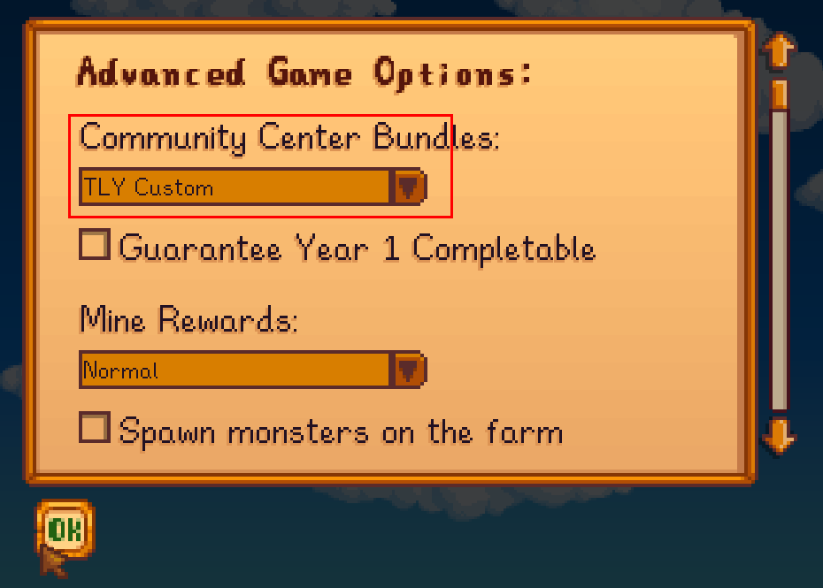
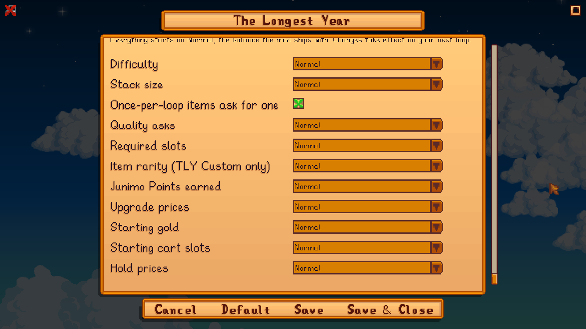
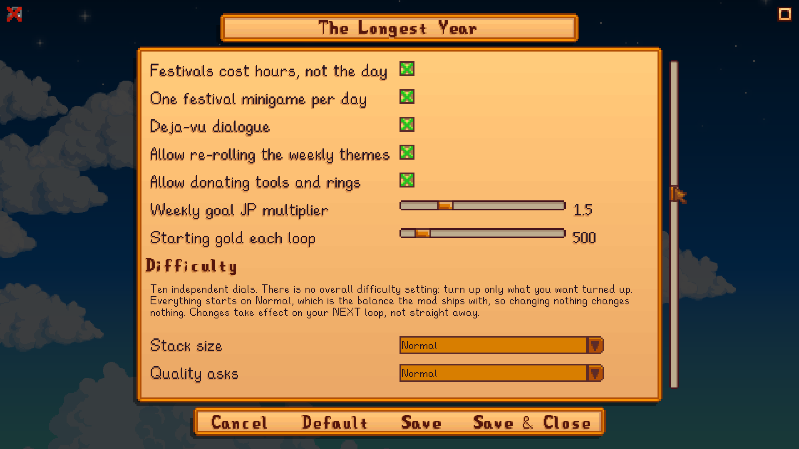

# The Longest Year

**Restore the Community Center within a single year — or the Junimos rewind the seasons and you begin again, a little stronger.**

A roguelite time-loop for Stardew Valley (PC).

⬇ **[Download on Nexus Mods](https://www.nexusmods.com/stardewvalley/mods/47192)**

**The Longest Year** turns Stardew Valley's first year into a roguelite loop. Each season asks you to give back enough of the land's bounty to the old Community Center hall. Fall short by a season's end and the Junimos turn time back to Spring 1 — the world resets, but the strength you've earned (and the power your offerings bank) can carry forward. Restore the whole Center inside one year to break the loop for good.

**Version 1.0.** The full first year, story and all. Bug reports and balance feedback are still very welcome; see [Giving feedback](#giving-feedback) below.

---

## See it played

**Emmalution** is playing the whole loop on YouTube, and her edited episodes are the best introduction to the mod there is. Thank you, Emma, for the videos and for the bug reports that came with them.

- Spring: [I must donate to the Community Centre OR RESET!](https://www.youtube.com/watch?v=fU4EVzlD1K8)
- Summer: [The Junimos challenged me to complete these bundles...](https://www.youtube.com/watch?v=WaAzDjMWmt8)

Channel: [youtube.com/@emmalution](https://www.youtube.com/@emmalution)

---

## What's New in 1.1.3

**Changed: loading a save is faster.** The base game's item routes now ship with the mod instead of being worked out on every load, which took several seconds. Nothing about how a board is built changed. If your mods change the game's data, TLY still works the routes out itself once and remembers them. Supported mods will get their own shipped answers over time.

**Changed: shipped item routes are tied to the mod version.** The routes that ship with the mod are only used by the TLY version they were made for. If the file and the mod ever disagree, TLY works the routes out itself once and remembers them, so an out-of-date file can never give a wrong board.

## 1.0.27

**New: the Traveling Cart brings Year 2 items.** Every cart visit has a 1 in 10 chance that one of its slots holds something a loop normally can't get before the Community Center is done: Garlic, Red Cabbage and Artichoke Seeds, Ginger Island crops and fish, Mr. Qi's goods, dishes whose recipe only airs in Year 2, and the same kinds of late-game items from your other mods. It is one chance per visit however many cart slots you have bought, and it only offers the kinds of things the cart already sells. Thanks to mysticalfairy25 for the idea.

**Fixed: the cart's special items show up again.** Rare Seed, Coffee Beans, the catalogues and the cart's other fixed items came after its random stock, so with TLY's cart slots they never made it onto the cart. Each one now takes a random slot like any other item. On the day the cart's guaranteed Red Cabbage Seeds visit comes up, the seeds always get a slot.

## 1.0.24

**New: Keep Trash Can.** Four new Loadout upgrades (Copper, Steel, Gold and Iridium, 50 / 100 / 175 / 300 JP) let you start each loop with your trash can at the tier you keep, instead of back at the basic one. Each tier opens once you have upgraded the can that far in the current loop. Thanks to tanky24u, whose trash can report led to this.

## 1.0.23

**New: a Gear tab in Junimo Upgrades.** Nine new upgrade chains give your tools and weapons the effect of a Forge enchantment, no Volcano needed: faster swings, cheaper energy, harder hits, wider charges, a bigger watering can, a steadier fishing line, and weapon damage, speed and defense. Each one covers every tool it fits at once. Gear that already has the real enchantment gets the better of the two, never both. Thanks to tanky24u for the suggestion.

**New: a Bundle Log tab on the Collections page.** Check which bundle items you still need this season from anywhere, without going back to the book. Thanks to Nijah for the idea.

**Changed: one Exp Boost chain for all skills.** Exp Boost I to V in the Efficiency tab boosts all five skills at once: +25%, +50%, +75%, double and +150%, for 150, 350, 650, 1,000 and 2,000 JP. Mastery Boost I and II give +50% and double Mastery experience for 500 and 1,000 JP. If you owned the old per-skill upgrades or Junimo Insight, they keep working until your next rewind, then they are removed and every JP you spent on them comes back. Thanks to tanky24u for the feedback.

**Changed: cheaper year-two seeds.** Pierre's Year 2 Seeds costs 5,000 JP (was 10,000), and the Garlic and Red Cabbage Mixed Seeds upgrades cost 2,000 each (were 3,000). Thanks to tanky24u.

**Fixed: the first save after a rewind could fail.** With Farm Type Manager packs (Stardew Valley Expanded has one), the game could get stuck on the saving screen the first night after a rewind and lose the day. The rewind now waits for every mod to finish starting the new day before it saves, and anything another mod leaves lying around that the game can't save is set aside for the save instead of losing the day. Thanks to tanky24u and SylviaStormsinger.

**Fixed: updating no longer resets your settings.** Mod managers replace the whole mod folder on an update, which took your settings with it. The mod now keeps a copy and puts it back. This one update still resets them once, since older versions never kept a copy. Thanks to tanky24u.

**Fixed: other mods keep their settings through a rewind.** Mods that save settings per farm (UI Info Suite 2, for example) went back to their defaults every loop. Now they carry over. Thanks to Nijah.

**Fixed: no more repeated items across bundles.** TLY Custom boards could ask for the same item in two bundles, such as a Common Mushroom in both Spring and Fall Foraging. Thanks to Nijah.

**Fixed: the trash can resets.** It was the only tool that kept its upgrade through the rewind. Thanks to tanky24u.

## 1.0.0

**The Longest Year is out of beta.** This is the story update. It's best found in the game, so start a new farm with Skip intro off and play.

There are also new options under Difficulty and Features in the mod's settings.

## 0.19.135

**Fixed: Artichoke, Garlic and Red Cabbage asks fit what you can grow.** Without the upgrade that has Pierre sell year-two seeds, these three crops only come from Mixed Seeds, but a bundle could still ask for dozens of them. Now a bundle, a weekly goal or a dish made from them asks for at most 2 on Easy, 3 on Normal, 4 on Hard and 5 on Extreme, going by your Stack Size setting. Once you own the Pierre upgrade they are asked for like any other crop. A board already in play keeps its counts until your next rewind.

**Clearer Junimo Points setting.** The tooltip now says what each step gives: Easy 1.5x, Normal 1x, Hard 0.75x and Extreme 0.5x. Harder settings give fewer points, so upgrades take more loops to afford.

**Everything that counts toward Perfection now starts over each year.** The rewind clears your shipping collection, your money earned, the fish you have caught, the dishes you have cooked and the Monster Slayer goals. Since money earned starts from zero, the letters from Mom or Dad and the Tribune's "up and coming" story come again each year. Anything you bought a keep for in the upgrade menu still comes back. Since the fish collection starts over, the first fish you catch each year is the easy beginner catch again, and bobber styles unlock again as you catch new kinds of fish, the same as in a new game.

**See what a theme pick takes off before you choose.** On Easy and Normal, the theme cards in the planning hub and the goal lists show a lowered goal with its full amount in brackets, such as "33 (44)". During the theme week, the weekly quest, the Season Goals tooltip and the bundle page show it the same way until you donate it. A goal that asks for a single item now shows its "1" too, on the theme cards and in Season Goals.

**Fixed: a marriage ends at the rewind.** Your spouse or roommate used to keep living in your farmhouse on the new loop, with your hearts back at zero. Now the rewind ends a marriage like every other relationship: your former spouse or roommate goes back to their own home and routine, your children and the spouse room go away, and you can court and marry again from the start. This also covers extra spouses from polyamory mods such as PolySweet. If your save still has a spouse you are no longer married to, it is repaired when you load it.

**Fixed: the Rusty Key no longer comes back for free.** After a rewind, Gunther could walk onto your farm on the first morning and hand you the Rusty Key again, even with the museum empty and no Keep Rusty Key bought. Now the key comes back only if you bought its keep, or once you donate 60 items to the museum again.

**Fixed: the weekly theme pick no longer runs dry.** You could get a week with one card and a "(no offer)" side, or a Monday with no theme pick at all. The planning hub now deals the themes you haven't picked this month first, then brings back this month's picks that still have goals for you. If no theme has anything left to ask for, a message tells you how many items the Community Center still needs by day 28.

**Fixed: fish bundles no longer ask for a silver or gold Goby.** Goby only bites in water so shallow that it always comes out base quality. Any fish that only lives in water that shallow is now asked for at base quality, and fish from other mods follow the same rule. If your board already asks for a silver or gold Goby, it is lowered to a plain Goby when you load your save.

**Loading a save is faster.** The mod now works out how deep the water is at each fishing spot once per map instead of once per fish.

**Fixed: Wildcard Day nights no longer favor the Stone Owl.** When the night event picked for a Wildcard Day could not happen, the next one came from a fixed list, so the Stone Owl turned up far more often than the others. Now another event is picked at random from the ones not tried yet.

## 0.19.116

**Focus cards: something to aim for in every loop.** At the start of each loop the Junimos deal three hands of cards: tools, buildings and knacks. You pick one card from each hand. Any time that year you can buy a picked card with JP, from the new Focus tab on the farm statue, and the Junimos deliver it: your tool is upgraded where it sits, a coop or barn goes up for free and finished, and a knack works right away. You keep it for every loop after. A card you don't buy waits for you in the upgrade menu at the end of the year, at the same price.

**A goal the Junimos especially want pays double JP.** Each week's theme card can hold one goal marked with an x2 badge. Every item you donate to it earns twice the usual JP.

**Fixed: the Keep tool offer finds your best tool.** It used to read only the first tool of that kind in your backpack, so a spare basic pickaxe could hide your iridium one. It now checks your backpack, Clint's counter and every chest on your farm, and keeps the highest tier it finds.

**Fixed: a random drawback can't cancel the week's own goals.** With Random pairings on, a card could draw "mines closed" while asking for a Cave Carrot. A drawback that would shut the only way to get one of the week's goals is now swapped for another.

**Fixed: villagers keep their routine after a rewind with the shortcuts kept.** Elliott, Sebastian, Willy and others headed for the beach could lose their routine for the day. The shortcuts are now open from the first morning of the new year.

## 0.19.97

**Fixed: island fish and forage from other mods' maps stay off the board.** Some mods add new spots you reach through Ginger Island, like the rainforest in Forager's Nooks and Crannies. Anything you could only get there could still end up in a year-one bundle. TLY now checks whether you can actually walk to a spot from your farm without going through the island, so island-only catches and forage stay off the board no matter which mod adds them, and so does anything sold only at the island shops. If your board already asks for one, that slot is swapped the next time you load your save. Thanks to iroeny for the report and the log.

**Fixed: the save right after a rewind works with other mods.** The game saves as soon as the Junimos rewind you to Spring 1, but that save skipped the step other mods use to get their data ready. With mods like Unlockable Bundles the save failed, and the old save folder was left behind. The rewind now saves the way a night does, and the old folder is cleaned up once the new save is written.

## 0.19.95

**A new Animals tab in the upgrade menu, with thirteen animal powers.** Morning Rounds pets every animal each morning, Warm Welcome gives new animals a head start on hearts, Quick Growth turns a baby into an adult after its first night with food, and there are more for hatching, births, coops and barns, rabbits, pigs, your horse and your pet. Your existing animal upgrades (Keep Horse, Keep Coop, Keep Barn, the Herd Book and the rest) moved to this tab at the same prices, and anything you already own stays owned. None of them makes a bundle ask for more.

**Festival memories.** From the second loop, villagers at a festival sometimes half-remember what you did there in an earlier loop: the egg hunt, the soup, your grange display, the ice fishing, who you danced with and who got your secret gift. No gameplay effect, and you can turn it off in Features.

**New difficulty option: Bundles per room (TLY Custom boards only).** Easy gives each Community Center room one or two fewer bundles, Hard one or two more, and Extreme fills every room to 9. It changes the Vault too: Easy has three Vault bundles, Hard and Extreme add more.

**Keep Bus Unlocked now unlocks once the bus is repaired,** so on a board with five or six Vault bundles you pay them all (or finish the Vault room) instead of stopping at four.

**Fixed: brown eggs count.** An egg slot takes white or brown eggs of its size, and you can mix colors toward one slot's count. Shrine goals work the same way. Thanks to flutegir for the report.

**Fixed: no more Ginger Island fish in bundles.** Lionfish, Stingray and Blue Discus (and Slimejack, which lives only in the Mutant Bug Lair) can no longer be asked for, even when another mod adds them somewhere else. If your board already asks for one, that slot is swapped the next time you load your save. Thanks to iroeny for the report.

**Fixed: the rewind is sturdier.** One broken carry-over no longer stops the whole rewind halfway, a save backup that fails no longer cancels the rewind, kept buildings come back on their own spot (and no longer on top of the Meadowlands starter Coop), and stashed items from a mod you switched off for a session are kept until you turn it back on.

**Plus a batch of smaller fixes:** the second milk or wool from Kitchen week and Double Yolk now shows up, Forager's Eye no longer piles up copies of old forage, the Mixed week bonus works on full-grown trees, Rain Dance and Storm Call can't be bought the day before green rain, villagers' déjà vu lines come back every loop, Keep Rod owners skip Willy's rod scene, and SMAPI logs are much smaller.

## 0.19.21

**Fixed: no more red Harmony error at startup with ExtraAnimalConfig.** With ExtraAnimalConfig or a similar animal mod installed, the game showed a red "Harmony patch failed" error from TLY when it started. That error is gone. On a Wildcard snow day your animals still stay inside, and the other mod's animal settings keep working. Thanks to pitytheviolins for the report.

**Rare fish pond products no longer decide when an item shows up.** TLY works out the earliest week you can get each item, and a fish pond product with only a tiny chance used to count. With Stardew Valley Expanded, that put Golden Pumpkin in week 5, when the real way to get it is the Spirit's Eve maze in week 12. A pond product now counts only when it turns up often enough to get in a run.

**Real routes for the items those ponds used to cover.** Some items had only a rare pond product as their route, so TLY now reads where they really come from: seeds from wild trees, Coral and Sea Urchins from the tide pools past the beach bridge, geodes from the mines, and the Pearl and Treasure Chest from the Squid Fest. They are asked for in the weeks you can actually get them.

## 0.19.18

**TLY Custom boards ask only for vanilla items.** Other mods' items are left out of what TLY Custom bundles ask for and what they give, so the balance holds whatever else you have installed.

**New setting: Allow mod items in custom bundles.** It sits next to Bundle source in the mod's settings menu (GMCM). On, TLY Custom bundles ask for and give other mods' items the way they used to. It is off on new farms. Saves you already have start with it on, so they carry on the way they were created. Like Bundle source, it belongs to the save you have loaded and a change applies at your next loop.

**Tech's Cross-Mod Bundles: a fresh board every loop.** With it installed, Normal and Remixed now roll a new Tech board at each reset instead of handing back the old one. Reloading a save keeps your loop's board, with TLY's difficulty changes, instead of bringing back an older Tech board.

**Fixed: a swapped-out item stays swapped.** When a bundle asks for something you can't get this year, TLY swaps it for something you can. That swap now stays put through reloads, instead of a different item turning up each time you load.

**If you play with other mods, please read this.** Turning on Allow mod items in custom bundles, or playing Normal or Remixed with other mods installed, can give you bundles that ask for items that are impossible to get. I found a quick way to cut down how many impossible mod items show up, but there will still be some. That will stay true until I start tuning for specific mods. Other mods are not officially supported, but if you report an issue with one, I will look at it.

Thanks to PixxiePerfect, who pointed me at Tech's Cross-Mod Bundles.

## 0.19.1

**Fixed: the Bundle Log shows the same counts as the Community Center.** After a theme week's discount ended, the Bundle Log could keep showing the lower count while the Community Center asked for the full amount (or the other way round right after picking a theme). The Log now reads the counts from the Community Center each time you open it. Reported on Reddit.

## 0.19.0: the Randomizer

**A new Randomizer section in the mod's settings, for runs that play out differently each time.**

Every option in it is off by default, so if you never open it, the game plays exactly as balanced. The weekly options take effect from next week's offer, and Random bundle rewards from the next loop.

- **Theme rerolls** (Off / Costs JP / Free). A Re-roll Themes button in the planning hub. On Costs JP the first reroll each week is 50 JP, each one after costs double, and the price goes back to 50 every week.
- **Random theme items.** Weekly goals are drawn evenly from everything a theme could ask for. Nothing impossible is ever asked.
- **Random pairings.** Each card keeps its theme's buff but gets a random drawback, never one that blocks that theme's own goals.
- **Random multiplier.** Each card shows its own JP multiplier, from 0.5x to 1.5x, for the JP from that theme's goals.
- **Mystery card.** About one week in four, one card is dealt face down. It shows only its multiplier, 1.25x to 1.75x, and the theme is revealed when you pick it.
- **Double theme week.** Once a season, in week 2 or 3, you take both cards: both buffs, both drawbacks and two goal lists.
- **Wildcard days.** One day each week gets a one-day twist, good, bad or odd. You see which day at the start of the week and the twist that morning.
- **Random shrine donations.** Extra weekly goals for items with no Community Center slot, donated on the farm statue's new Donate tab. Missing them never fails you, but the theme keeps its drawback.
- **Random bundle rewards.** Bundle rewards are picked at random, starting from the next loop. The Vault bundles are included.
- **Random cart days.** The Traveling Cart comes on random days, about two a week, never on a festival.

The old **Allow re-rolling the weekly themes** switch has moved into the Randomizer section. If you had it on, Theme rerolls is set to Free.

**Also fixed: Dried Fruit slots no longer ask for grapes.** The Dehydrator turns grapes into Raisins, not Dried Fruit, so a Dried Grapes slot could never be filled. Reported by Treedomy.

**Also fixed: a festival that ends while someone is talking no longer freezes the night.**

Thanks to Nijah, whose Nexus thread started this.

## 0.18 in brief

- **Seven new keeps.** The Herd Book brings your registered animals back with their names and hearts, and Junimo Upgrades adds Keep Fish Pond, Keep Lost Books, Keep Farm Decor, Keep Worn Gear, Keep Farmhouse Furniture and Keep Special Orders Board.
- **Restart the year.** A button on the Junimo Shrine starts a fresh loop whenever you like. Season pity is gone; use the Difficulty settings instead.
- **Spring, Summer and Fall Returns.** One-week boosts that bring a past season's fish and forage back.
- **One Difficulty setting** sets every dial at once, and once-per-loop items like the legendary fish are only ever asked for once.
- **Bundles only ask for what a year can reach.** Ginger Island, year 2 shops, the wrong water or season and other mods' items a year can't reach stay off the board, and a board you already have gets repaired when you load it.
- **Cookbook and Craftbook start with four free slots**, and a fourth tier takes them to 20.
- **Picking a theme lowers that week's goals** on Easy and Normal.

Every 0.18 change, with who reported it, is in [CHANGELOG.md](CHANGELOG.md).

---

## Features

- **Seasonal time-loop.** Each season has a donation minimum. Miss it and the year unwinds to Spring 1.
- **Junimo Points.** Donations earn JP — scaled by rarity and by how late in the year you give. JP banks across loops.
- **Junimo Upgrades.** Spend JP on upgrades that let you hold on to some of what you gained: skill levels, tool tiers, recipes, buildings, a kept pet, the power books you have read, your wallet items and Stardrops, the Junimos' own gifts (greenhouse, quarry bridge, boulder, minecarts, bus), and more.
- **Focus cards.** At the start of each loop, pick one card from each of three hands: tools, buildings and knacks. Buy a picked card with JP any time that year, the Junimos deliver it, and you keep it for later loops.
- **Animal powers.** The upgrade menu's **Animals** tab sells permanent animal upgrades. None of them makes a bundle ask for more. Your animal keeps (Keep Horse, Keep Pet, Keep Coop, Keep Barn, Keep Silo, the Start with animals and the Herd Book) live on the same tab.
  - **Morning Rounds:** every animal on your farm gets petted each morning, like an Auto-Petter.
  - **Warm Welcome I, II and III:** new animals arrive with 1, 2 or 3 hearts. Animals coming back from the Herd Book keep their own hearts.
  - **Quick Growth:** a baby animal grows up after its first night with food.
  - **Fast Hatch:** eggs in an incubator hatch in half the time.
  - **Growing Herd:** cows, goats, sheep and pigs give birth about four times as often. Shows up once you've had a Big Barn.
  - **Snug Barn:** your animals stay happy on rainy and Winter days they spend indoors.
  - **Busy Coop:** ducks lay every day and rabbits every 2 days.
  - **Busy Barn:** goats and sheep produce every day.
  - **Molting Season:** ducks have an extra 25% chance to leave a Duck Feather instead of an egg. Shows up once you've owned a duck.
  - **Lucky Rabbits:** rabbits always leave a Rabbit's Foot instead of Wool. Shows up once you've owned a rabbit.
  - **Truffle Hog:** each truffle a pig digs up has a 25% chance to be two. Shows up once you've owned a pig.
  - **Swift Horse:** your horse runs about 10% faster. Needs Keep Horse.
  - **Horse Flute:** start every loop with a Horse Flute. Needs Keep Horse.
  - **Loyal Pet:** your pet brings presents twice as often, starting at 3 hearts instead of 5.
- **JP Boosts.** The Junimo statue on your farm sells this-loop edges for JP: tomorrow's rain or a lucky day, a free late night, stacking forage/fish/crop/mine/drop chances, a faster walk, a season of cheaper shops, faster friendships, extra energy, a skill level on the spot, or an elevator stop you have not earned yet. An Active tab shows what is running and a Plan tab shows what each keep still needs.
- **Weekly themes.** Each week, pick one of two themes (Foraging, Farming, Fishing, Mining, Mixed, Spelunking, Artisan, Kitchen) for a bonus and a paired liability. Goals follow the season gate and the weekly bonus is paid per goal.
- **Randomizer.** An optional settings section that adds chance to the weekly themes, goals, bundle rewards and the cart. Everything in it starts off.
- **Carryover surfaces.** A **Bundle Log** book that tracks each season's goals, a Cookbook and Craftbook to bank recipes, a **Herd Book** that brings your registered animals back with their hearts, and a Junimo Stash chest that survives resets.
- **A story.** Play it to find out.
- **A starved Traveling Cart.** Joja has squeezed the merchant's suppliers — the cart carries **one item** per visit until you unlock more stalls with the **Cart Stall** upgrades (and Cart Whisperer previews what's coming). Prefer the full vanilla cart? Turn off `LimitTravelingCartStock`.
- **The town half-remembers.** Villagers you have spent a lot of time with across loops occasionally say something uncanny. From the second loop, festivals stir it up too. At most festivals one villager half-remembers something you did there in an earlier loop: the egg hunt you won, the dance you shared, what you put in the soup. Talk to people to find out who. Win the egg hunt and someone will bring it up at the next Egg Festival, and everyone you have danced with may remember it when you ask again. No gameplay effect, and it never explains itself. Toggle in Features.
- **Break the loop.** Finish the Center in a year and the year ends the next morning. Then loop again or keep playing to the end of the year.

## Requirements

- **Stardew Valley 1.6+** (PC: Windows, Linux, macOS)
- **SMAPI 4.0.0** or newer
- A **new save** (any farm type; see the note under Limitations)

## Install

1. Install [SMAPI](https://smapi.io/) (4.0.0+).
2. Download the latest `TheLongestYear` release and unzip it into your `Stardew Valley/Mods` folder, so you have `Mods/TheLongestYear/TheLongestYear.dll`.
3. Launch the game through SMAPI.
4. **Start a new game** on any farm type. Leave **Skip intro** off the first time: the mod's own opening plays in place of the vanilla one and explains the loop. Tick it on later farms to go straight to the theme picker.
5. **Community Center Bundles** under **New → Advanced Options** defaults to **TLY Custom**: every loop rolls a fresh board from the vanilla + remix pools plus the mod's own authored bundles, using vanilla items only unless you turn on Allow mod items in custom bundles. Prefer the game's own board (or another bundle mod's)? Pick **Normal** or **Remixed** there instead. The mod keeps that board and re-rolls it the same way on every reset. With other mods installed, those bundles may not reshuffle each loop and may ask for items you can't get. (You can change this later: `Bundle source` in GMCM switches an existing save between all three, applying at its next loop.)

   

## How it works

- **The opening.** A new game starts with the mod's own opening, which explains the loop. You wake on Spring 1 and pick your first **weekly theme**.
- **Weekly themes.** Each week you choose one of two offered themes. Room themes (Foraging, Farming, Fishing, Mining) take goals from their Community Center room; Spelunking, Artisan and Kitchen take goals by item kind from anywhere on the board, and Mixed takes anything. Goals follow what the season gate demands first; the weekly JP bonus is paid goal by goal and the drawback lifts when every goal is done. The planning hub opens at the start of each week.
- **Seasonal goals.** The **Bundle Log** book (click to open) tracks each season's required donations. Each season has a minimum you must donate to the Center before the season turns. **Miss it and the year unwinds to Spring 1.**
- **Fail night.** When a season's minimum is missed, the Junimos rewind the year. Before the upgrade menu opens, they ask whether to keep the same bundle board for the next loop or let time reshuffle it. The first hold is free; each further hold in a row costs 50, 100, 200, then 300 JP, and reshuffling resets the price. This works on every bundle source.
- **Junimo Points (JP).** Donations earn JP, scaled by rarity and by how late in the year you give (later seasons are worth much more). JP banks across loops.
- **Junimo Upgrades.** On every loop reset (and on a win), spend banked JP on upgrades that let you *hold on to some of what you gained* next loop — skill levels, tool tiers, recipes, buildings, a kept pet, the power books you have read, your wallet items and Stardrops, and more.
- **Focus cards.** Before the first planning hub of every loop, the Junimos offer three hands of cards in turn (tools, buildings, knacks) and you pick one from each. Buy a picked card with JP from the farm statue's Focus tab any time that year. The Junimos deliver it then and there, and you keep it for later loops. A card you don't buy stays in the upgrade menu at the end of the year.
- **JP Boosts.** The Junimo statue on the farm sells this-loop edges for JP any day (weather, luck, a free late night, stacking bonuses, a temporary skill level, an elevator stop) and shows what is running on its Active tab.
- **Carryover surfaces on the farm.** A **Cookbook** (kitchen) and **Craftbook** (table) let you bank recipes to keep; a **Junimo Stash** chest preserves a few items across resets.
- **Restarting.** Want a fresh loop before the season runs out? The Junimo Shrine's **Restart the year** button ends the day and runs a Fail night without the Junimo scene: keep or reshuffle your bundles, spend JP, bank recipes, and wake on Spring 1. It counts as a loop, and it works after Keep playing too.
- **Winning.** Restore the entire Community Center within a year to break the loop. The year ends the next morning; then loop again or keep playing to the end of the year.

## Difficulty

Ten difficulty dials live in the mod's settings menu (GMCM) under **Difficulty**, with one overall **Difficulty** option above them. Pick a level there and every dial switches to it, then change any single dial you like. Every dial has four steps, **Easy / Normal / Hard / Extreme**, and every one starts on **Normal**, which is the balance the mod ships with. Changing nothing changes nothing.

**Changes take effect on your next loop, not straight away.** The dials are stamped onto your save when a loop begins, so the year you are already playing keeps the rules it started under.



**What the bundles ask for**

- **Stack size.** How many of an item a slot asks for, as a share of what a week of going after it actually yields: Easy 10 to 30%, Normal 20 to 50%, Hard 50 to 65%, Extreme 65 to 80%, and never above 80%. Fish, forage, crops, crab pots, monster drops, the mines, animals and machines each have their own yield behind that number, and a yield is capped at one stack of 99 (Slime, Bat Wings and the like), so an Extreme ask of 80 is a stack, not a share. Artifacts stay at one. Money bundles are never affected.
- **Once-per-loop items ask for one.** On by default. The five legendary fish, the two books hidden around town and the Golden Pumpkin can only be had once in a loop, so a bundle never asks for more than one of them whatever Stack size says. Off, they scale like everything else. Takes effect at the next reset.
- **Quality asks.** How often a slot wants a silver or gold star. Items the game never gives a star to are still never asked for at quality, at any step.
- **Required slots.** How many of a bundle's shown items you must actually donate. Hard asks for one more, Easy one fewer, Extreme asks for all of them.
- **Item rarity.** Weights bundles toward harder items: rarer, later in the year, or needing a keg or a press. **TLY Custom bundles only** (see below).
- **Bundles per room.** How many bundles each Community Center room has. Easy has one or two fewer, never below 2. Normal is the usual count. Hard has one or two more. Extreme fills every room to 9. Extra bundles come from the same pool as the rest and are due in their own season. The Vault changes too: Easy drops its most expensive bundle, Hard adds one at twice that price, and Extreme adds another at 1.6 times the Hard one. The bus is repaired once every Vault bundle on your board is paid, and the season checkpoints never ask for more Vault bundles than your board has. The Missing Bundle never changes. **TLY Custom bundles only** (see below).

**What you carry between loops**

- **Junimo Points earned.** Scales every JP award, so progress across loops is faster or slower. The season ramp keeps its shape, so late-season donating is still worth the most.
- **Upgrade prices.** Scales what upgrades cost in the upgrade menu.
- **Starting gold.** Scales the `StartingMoney` value rather than replacing it. Extreme starts you with nothing.
- **Starting cart slots.** How many items the Traveling Cart offers before you buy any Cart Stall upgrade. On Hard and Extreme the cart is empty until you buy Cart Stall I.
- **Hold prices.** Scales the JP price of keeping your board on a Fail night. The first hold stays free at every step.

**Two dials do not work on vanilla boards.** Item rarity and Bundles per room apply to **TLY Custom** bundles only, because changing which item a vanilla bundle asks for, or how many bundles a room has, would be changing the board. Stack size, quality asks and required slots all work on vanilla Standard and Remixed boards too.

`tly_difficulty` in the SMAPI console prints what your save is actually running under, including anything you have changed since your last loop. Please attach it to any balance report.

## Switching bundle source later

You are not locked into the board you picked when you started. **Bundle source** in the mod's settings menu (GMCM) is one setting with three choices, and you can move an existing save between any of them:

- **TLY Custom** - the mod composes a fresh board every loop from the vanilla and remix pools plus its own authored bundles. It asks only for vanilla items and gives only vanilla rewards: other mods' items are left out so the balance holds. **Allow mod items in custom bundles**, next to Bundle source, lets other mods' items in. It is off on new games, and saves from before 0.19.4 start with it on. Other mods aren't supported, so with it on a bundle may ask for an item you can't get.
- **Normal** - the game's own standard bundle layout, re-rolled the same way each loop.
- **Remixed** - the game's own remixed layout, likewise.

Another bundle mod's board is covered by Normal or Remixed: whatever the game generates is what the mod keeps. Using Normal or Remixed with other mods (bundle mods included) is allowed, but the bundles may not reshuffle each loop and may ask for items you can't get. With Tech's Cross-Mod Bundles, both Normal and Remixed roll a fresh board each loop.

Like the difficulty dials, a switch applies at your **next loop**, not straight away. The year you are already playing keeps the board it started with. The setting belongs to the save you have loaded. On the title screen it only picks what a new game starts with, so one farm's choice never changes another's.

**Keeping your board on a Fail night works on all three.** If you hold, you get the same board back next loop whichever source it came from.

## Configuration

The **Features** section of the settings menu turns individual parts of the mod off or tunes them, and changes there apply straight away:



All knobs live in `Mods/TheLongestYear/config.json` (created on first run). The values most worth tuning:

| Setting | Default | What it controls |
|---|---|---|
| `Jp.CommonJp` / `UncommonJp` / `RareJp` / `VeryRareJp` | 1 / 3 / 10 / 25 | JP awarded per donated item by rarity |
| `Jp.SeasonMultipliers` | `[1.0, 1.5, 2.5, 4.0]` | Per-season JP multiplier (Spring→Winter) |
| `Jp.BundleCompletionBonus` / `RoomCompletionBonus` / `WeeklyQuestCompletionBonus` | 15 / 60 / 30 | Bonus JP for milestones (×season multiplier) |
| `StartingMoney` | 500 | Gold at the start of each loop |
| `BundleQuotas` | per-bundle | How much each percentage-bundle asks for |
| `StashTileX/Y` | `0,0` (auto) | Where the Junimo Stash chest is placed (`0,0` = auto-pick near the farmhouse). The Bundle Log / Cookbook / Craftbook are placeable furniture you can put anywhere. |
| `LimitTravelingCartStock` | `true` | Cap the Traveling Cart to the stalls unlocked by the Cart Stall upgrades (one item until Cart Stall II). `false` = full vanilla cart |
| `BundleSource` | `Engine` | One setting, three values: `Engine` (the mod's own board every loop, the new-game **TLY Custom** choice), `Normal` or `Remixed` (the game's own board of that kind, or another bundle mod's, re-rolled the same way each loop). Only the default a new game starts on: each save keeps its own choice, which the in-game settings menu changes, and it takes effect at the next loop. See [Switching bundle source later](#switching-bundle-source-later) |
| `AllowModItemsInCustomBundles` | `false` | Whether TLY Custom bundles may ask for and give other mods' items. Only the default a new game starts on: each save keeps its own choice (saves from before 0.19.4 start with it on), which the in-game settings menu changes, and it takes effect at the next loop. Other mods aren't supported, so with it on a bundle may ask for an item you can't get |
| `BundleHoldCosts` | `[0, 50, 100, 200, 300]` | JP cost of keeping the same bundle board on a Fail night, by how many holds you have taken in a row (first is free; the last value repeats). Reshuffling resets the count |
| `Enabled` | `true` | Master switch: turn the whole mod off to play vanilla |

Upgrade prices are defined in the upgrade catalog (e.g. Cookbook/Craftbook tiers at 150 / 350 / 700 / 1200 JP). Feedback on these is welcome.

## Is this a bug?

A few things get reported often enough to be worth answering up front.

**Demetrius never shows up about the cave, I just get a popup asking mushrooms or bats.**

That is the mod, working as intended. His scene plays once per playthrough; from the second loop on, walking into the farm cave gives you the choice directly instead of replaying a cutscene you have already watched. The mushrooms-or-bats decision is re-offered every loop because the rewind clears it.

**The Traveling Cart only has one item.**

Also intended. Joja is squeezing the merchant's suppliers, and the Cart Stall upgrades in the upgrade menu add slots back. If you would rather have the full cart, turn off LimitTravelingCartStock in the config.

**I did the Egg Hunt and now Lewis will not let me do it again today.**

Since 0.14.1, a festival's main event runs once per day. Festivals in this mod do not end your day, so you can walk out and back in - which used to restart the whole festival and let the hunt be repeated for the prize. The stalls, the shop and everyone at the festival still work on a repeat visit. A new loop is a clean slate: as far as the valley is concerned the festival has not happened yet, so you get to do it again.

**A bundle is asking for silver or gold on something that cannot have a quality.**

That was a bug and it is fixed. Quality is only ever asked for on things the game itself gives quality to (crop harvests, rod-caught fish, spawned forage). Existing boards pick the change up at the next reset.

**A weekly goal ticked off without me donating anything.**

Fixed in 0.14.0. Finishing a bundle that only needs some of its listed items used to mark the rest as filled, which credited goals you never handed in. A goal now waits for the real donation.

**I bought Keep Bus Unlocked and the Vault bundles are still on the board.**

Intended. The gift keeps the bus and the desert open from day 1; the Vault bundles are still part of restoring the Center, still have to be paid, and still earn JP. Completing them again does not replay the repair scene. Every Gift of the Junimos works this way.

**The skill level I bought at the statue was gone after the rewind.**

Intended. Crash Course levels are temporary: they last the loop, never reach level 10, and cannot be kept. Only levels you earn open the Keep Level rows on a Fail night.

**Elevator Pass says "Enter the mine first", or a weather boost says "Not now".**

Both intended. The pass extends the elevator from wherever it already reaches, so it needs one trip into the mine first. Rain Dance and Storm Call are refused on day 28 and the day before a festival, because the game forces sunshine on those mornings and the JP would be wasted.

**My enchanted sword lost its enchantments in the Junimo Stash.**

Fixed since 0.16.7. Tools and weapons in the stash keep their enchantments, forged gems, bait and tackle across the rewind.

Anything not on this list, please do report - the bugs tab on Nexus is read.

## Limitations

- **PC only.** No Android port yet.
- **Other mods are not officially supported.** TLY Custom boards ask only for vanilla items unless you turn on Allow mod items in custom bundles (off on new games; saves from before 0.19.4 start with it on), so by default other mods' items are left out and the balance holds. Normal or Remixed with other mods (including other bundle mods) is allowed, but the bundles may not reshuffle each loop and may ask for items you can't get. If something goes wrong with a specific mod, report it and I will take a look.
- **Farm types are balanced as a set, not individually.** The bundle asks are sized from Standard farm yields. Each other type trades one thing for another (Riverland and Beach: more fish, less field; Forest: more forage; Hilltop: more ore; Wilderness: more monsters; Meadowlands: easier animals), so the year is a little easier in some bundles and a little harder in others. Beach farm's no-sprinklers rule makes its crop bundles a real step harder. Custom farm maps that replace a vanilla slot load fine but are untested for balance.
- **Start on a new save.** A run can only begin from a new game; other saves load normally and are left untouched.
- Multiplayer is untested.

## Giving feedback

What helps most right now:

1. **Difficulty**: do the seasonal minimums feel fair? Too punishing, too easy? Which season wall hit hardest?
2. **Pricing**: are JP earnings and upgrade costs well-balanced? What did you save for first, and did it feel worth it?
3. **Pacing**: how many loops before the run "clicked"? Did the carryover make later loops feel meaningfully stronger?
4. **Bugs / crashes**: include your `SMAPI-latest.txt` (`Stardew Valley/ErrorLogs/`).

## Art wanted

The mod leans on vanilla sprites for most things. If anyone would enjoy making some custom **sprite artwork** (the shrine, the stash chest, icons), I'd genuinely love to accept it and credit you. Drop a note in the comments.

*Banner art by **cwybabiesucks**. Book art by **supercam19**. Thank you both!*

## Translations

As of 0.11.60, every player-visible string in the mod lives in a JSON file
(`i18n/default.json`) — the mod is fully translatable with no DLL edits or rebuilds. See
[`docs/TRANSLATING.md`](docs/TRANSLATING.md) for how to add a language. If you translate it,
let us know (Nexus DM or GitHub issue) and we'll link your work from the mod page.

---

## Thanks

This mod is shaped by the players who report bugs and suggest ideas. Every one of these made it better. Thank you!

- **tanky24u**: suggested the Herd Book and Restart the year, and reported ten bugs and balance problems.
- **FayGabi**: rings in the Dye bundle, Friendship 101 in the Book bundle, Chests Anywhere in the stash, once-per-loop items, and a new farm quit before its first night.
- **ChaoticMindset**: Willy's letter, quest scenes and Gunther's Rusty Key coming back every loop, and the Joja Mart bundle.
- **Emmalution**: played the whole loop on YouTube; her stream found the villager first-meeting lines and the weekly goals that ticked for free.
- **Dummy Dog Ben**: played it on YouTube; the stream turned up the shrine restart order, week 1 quality and artifact goals, the Dye bundle, Marnie's pet visit and tooltips running off the screen.
- **gazumbrado**: Golden Egg and legendary fish asks, fish quantities, Keep Bus Unlocked, and the Skip intro checkbox.
- **Thrippa**: eggs in the Foraging bundles and year-2 seeds from other mods.
- **ozzy2540**: seasons failing under Challenging CC Bundles, and a finished season that could still fail.
- **Mycatisinapiano1528**: Marlon selling back last loop's items, and Cactus Fruit before the desert.
- **ShadowedAciexox**: dried fruit and smoked fish names, and Gil's Trophies asks.
- **ada113**: must-donate-all season gates, and when the Cookbook and Craftbook open.
- **asteriaths**: getting stuck on a second festival visit, and Chests Anywhere in the stash.
- **spenderg**: out-of-season fish in weekly themes, and a controller double press.
- **elaineofshalott**: suggested Keep Fish Pond.
- **amaliekirstine**: festival contests and cutscenes stopping the clock.
- **SilviaVA**: the Dye bundle asking for things a year cannot reach.
- **RiseiJaku**: Zoom Level and UI Scale surviving the rewind.
- **goblinslayer66666**: the Difficulty setting reaching Hard and Extreme.
- **gmastern1**: quitting after a failed season skipping the rewind.
- **pitytheviolins**: bundles asking for a dish from another mod's shop, and a Harmony error at startup with ExtraAnimalConfig.
- **Tottelotta123**: Garlic Cultivation and its price.
- **khauser13**: egg colors in the quest log, and the Advanced Options screenshot.
- **ggrace67**: weekly goals that ticked without a donation.
- **victoriatauanem**: a Normal-bundles farm switching to custom bundles at the rewind.
- **Ninjamaid**: an Ostrich Mayo ask from another mod.
- **PixxiePerfect**: pointed me at Tech's Cross-Mod Bundles.
- **Nijah, nyxnyx2234, Bumblewyn, IshoMoogoo and lexihope**: reports that shaped the early balance passes.
- **supercam19**: the book art, and the fix that refills mine carts and barrels every loop.
- **cwybabiesucks**: the banner art.
- **u/Gribbleby**: the idea for villagers' déjà vu dialogue.

---

## Also by this author

- [**Android Consolizer**](https://www.nexusmods.com/stardewvalley/mods/41869) — Full console-style controller support for Stardew Valley on Android.
- [**Cart Catalog**](https://www.nexusmods.com/stardewvalley/mods/47146) — Order from the Traveling Cart's daily stock; items arrive in a package on your porch the next morning.
- [**Nap Time**](https://www.nexusmods.com/stardewvalley/mods/42616) — Nap in bed to recover energy without ending the day. Configurable rate and wake-up cap. PC + Android.

## Source

Open source (MIT) — [github.com/sonofskywalker3/TheLongestYear](https://github.com/sonofskywalker3/TheLongestYear)

---

<!-- GitHub-only appendix (not part of the Nexus description) -->

## Building from source

```bash
dotnet build src/TheLongestYear/TheLongestYear.csproj -c Release   # builds + deploys to the Mods folder
dotnet test  TheLongestYear.sln -c Release                          # runs the unit suite
```

Core game logic lives in `TheLongestYear.Core` (pure, unit-tested); SMAPI/Harmony glue lives in `TheLongestYear`.

## Credits

By **sonofskywalker3**. Banner art by **cwybabiesucks**. Book art by **supercam19**. Deja-vu villager dialogue idea by **u/Gribbleby**. Thanks to **Emmalution** for playing it on YouTube and for the feedback that shaped 0.16 and 0.17. Built on [SMAPI](https://smapi.io/) and [HarmonyX](https://github.com/BepInEx/HarmonyX). Stardew Valley is a trademark of ConcernedApe.

## License

Released under the [MIT License](LICENSE).
